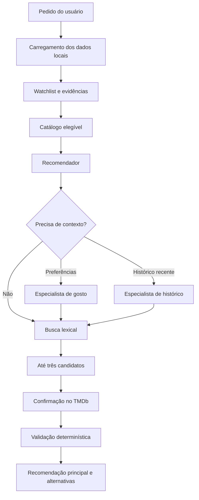

# AgenticBoxd

Sistema local de recomendação de filmes baseado na watchlist do Letterboxd. A aplicação combina dados pessoais de avaliação e histórico com informações do TMDb e inferência local pelo Ollama para responder a pedidos como “quero um suspense curto” ou “algo parecido com o que assisti recentemente”.

A recomendação é restrita à watchlist do usuário. Antes de exibir um resultado, o sistema confirma a existência do filme e os fatos apresentados no TMDb.

## Destaques

- Arquitetura multiagente com especialistas de gosto, histórico e recomendação.
- Inferência local com Ollama, sem depender de um provedor de LLM para executar o fluxo principal.
- Busca paginada sobre dados locais, com contexto controlado para o modelo.
- Filtros determinísticos de ano e duração.
- Evidências rastreáveis para preferências pessoais e fatos dos filmes.
- Validação da resposta final contra a watchlist, o cache do TMDb e as restrições do pedido.
- Limites explícitos para chamadas de modelo e ferramentas.
- Suíte de testes com 73 casos e avaliadores reproduzíveis.

## Arquitetura



O especialista de gosto cria um perfil resumido a partir das avaliações, reviews, curtidas, favoritos e listas. O especialista de histórico só é acionado quando o pedido depende de datas, reassistidas ou do que foi visto recentemente. O recomendador coordena o fluxo, seleciona candidatos e produz a resposta final.

O código mantém as regras essenciais fora do modelo: a origem dos candidatos, os filtros objetivos, os fatos confirmados, as referências usadas e os limites de execução.

## Tecnologias

- Python 3.11+
- LangChain e Pydantic
- Ollama com Qwen ou outro modelo compatível
- TMDb API
- unittest
- LangSmith opcional para avaliação e observabilidade

## Instalação

```powershell
python -m venv .venv
.\.venv\Scripts\Activate.ps1
python -m pip install -r requirements.txt
ollama pull qwen3.5:4b
```

No Linux ou macOS:

```bash
python -m venv .venv
source .venv/bin/activate
python -m pip install -r requirements.txt
ollama pull qwen3.5:4b
```

## Configuração

Crie `.env` na raiz do projeto:

```dotenv
TMDB_API_TOKEN=seu_token_de_leitura
OLLAMA_MODEL=qwen3.5:4b
OLLAMA_BASE_URL=http://localhost:11434
CINE_DATA_DIR=data
```

`TMDB_API_TOKEN` é obrigatório. As demais variáveis são opcionais.

## Dados do Letterboxd

Exporte seus dados do Letterboxd e coloque-os em `data/`, ou no diretório definido por `CINE_DATA_DIR`. O programa lê os arquivos abaixo.

Arquivos obrigatórios:

| Arquivo | Colunas usadas |
| --- | --- |
| `watchlist.csv` | `Name`, `Year`, `Letterboxd URI` |
| `ratings.csv` | `Name`, `Year`, `Rating` |
| `reviews.csv` | `Name`, `Year`, `Rating`, `Review`, `Tags` |

Arquivos opcionais:

| Arquivo | Colunas usadas |
| --- | --- |
| `watched.csv` | `Name`, `Year`, `Letterboxd URI` |
| `diary.csv` | `Name`, `Year`, `Rating`, `Rewatch`, `Tags`, `Watched Date` |
| `profile.csv` | `Favorite Films` |
| `likes/films.csv` | `Name`, `Year` |
| `lists/*.csv` | `Position`, `Name`, `Year` |

O sistema mantém localmente o cache do TMDb e o perfil de gosto para evitar trabalho repetido entre execuções.

## Execução

Com o Ollama em execução e o ambiente configurado:

```bash
python app.py
```

Exemplos:

```text
Quero um suspense curto para assistir hoje.
Recomende ficção científica lançada depois de 2015.
Escolha um filme de até 90 minutos.
Quero algo relacionado ao que tenho visto recentemente.
```

O resultado apresenta uma recomendação principal e pode incluir até duas alternativas. Cada filme vem acompanhado de fatos confirmados, uma justificativa e as evidências usadas na decisão.

## Avaliação e testes

Execute os testes unitários e a verificação de compilação:

```bash
python -m unittest discover -s tests -v
python -m compileall app.py src evals tests
```

Os testes cobrem carregamento e cache dos dados, busca na watchlist, filtros, evidências, roteamento entre especialistas, limites de execução, observabilidade e estrutura das recomendações.

O benchmark de avaliação fica em `evals/`:

```bash
python -m evals.run_benchmark
```

O LangSmith é opcional e pode ser usado para acompanhar latência, chamadas, tokens e qualidade dos resultados. O projeto oculta entradas e saídas por padrão fora de um ambiente de demonstração.

## Limitações

- A busca é lexical e não identifica relações semânticas que não apareçam nos dados indexados.
- A qualidade depende da cobertura do TMDb e do modelo escolhido.
- Resultados podem variar entre versões do modelo, do Ollama e das dependências.
- O matching por título e ano pode rejeitar versões, relançamentos e títulos ambíguos.
- O projeto atualmente não oferece interface web, API ou persistência de conversa.

## Estrutura

```text
.
├── app.py                    # Entrada da aplicação e composição do fluxo
├── tmdb.py                   # Busca e confirmação de filmes no TMDb
├── src/
│   ├── agents/               # Especialistas de gosto, histórico e recomendação
│   ├── tools/                # Ferramentas chamadas pelos especialistas
│   ├── local_data.py         # Busca, evidências e cache local
│   ├── models.py             # Modelos de domínio e saída
│   └── observability.py      # Métricas e tracing opcional
├── evals/                    # Avaliadores e benchmark
└── tests/                    # Testes automatizados
```
