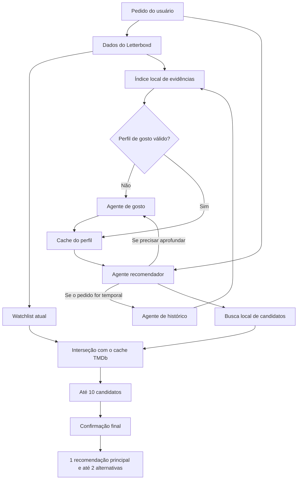

# AgenticBoxd

Sistema local de recomendação de filmes que usa dados exportados do Letterboxd, informações confirmadas pelo TMDb e três agentes especializados executados com Qwen pelo Ollama.

O projeto foi criado para estudar LangChain e coordenação multiagente com uma restrição central: **todo filme recomendado precisa estar na watchlist atual do usuário e ter seus fatos confirmados pelo cache do TMDb**. O modelo pode decidir quais consultas e especialistas usar, enquanto o código mantém as regras que não podem depender da interpretação de um LLM.

## Principais características

- Inferência local com Qwen via Ollama.
- Três papéis especializados: gosto, histórico e recomendação.
- Perfil de gosto persistente e reutilizável entre execuções.
- Consultas locais paginadas em vez de enviar todos os CSVs ao modelo.
- Busca lexical sem diferenciação de acentos ou maiúsculas.
- Filtros determinísticos de ano e duração.
- Recomendações restritas à interseção entre watchlist e cache TMDb.
- Busca compacta de até cinco candidatos e confirmação final de até três filmes.
- Até três recomendações por pedido, com uma escolha principal e até duas alternativas.
- Referências verificáveis para evidências pessoais e fatos dos filmes.
- Limites de chamadas por agente e por pedido.
- Fluxo dos agentes exibido em tempo real no terminal.
- Sem observabilidade ou inferência em serviços externos.

## Arquitetura



O sistema preserva autonomia onde ela é útil: o recomendador escolhe termos de busca, decide se precisa aprofundar sinais de gosto e consulta o histórico quando o pedido envolve contexto temporal. Restrições de catálogo, confirmação factual, referências e limites de execução são aplicadas pelo código.

### Agentes

| Agente | Responsabilidade | Dados acessíveis | Saída |
| --- | --- | --- | --- |
| Gosto | Identificar preferências sustentadas por avaliações, reviews, curtidas, favoritos e rankings | Ferramenta local de evidências de gosto | `TasteProfile` com preferências e referências |
| Histórico | Investigar padrões temporais, datas, textos e reassistidos | Ferramenta local de histórico | `HistoryContext`, que pode não conter padrões |
| Recomendação | Interpretar o pedido, escolher consultas e selecionar os filmes finais | Perfil persistido, especialistas opcionais, catálogo confirmado e detalhes finais | Uma recomendação principal e até duas alternativas validadas |

Não há um quarto agente supervisor. A coordenação fica no agente recomendador, o que reduz chamadas e mantém a arquitetura adequada a um modelo local de 4 bilhões de parâmetros.

## Fluxo de uma recomendação

### Primeira execução ou cache inválido

1. O projeto carrega os arquivos exportados do Letterboxd.
2. A watchlist é cruzada com o cache do TMDb.
3. O agente de gosto consulta evidências locais e cria o perfil persistente.
4. O recomendador recebe o pedido e o perfil.
5. Ele pode consultar um especialista e reformular a busca conforme a necessidade.
6. A busca retorna páginas de candidatos confirmados.
7. Uma chamada final confirma até três candidatos.
8. O modelo escolhe até três filmes, define um deles como principal e associa referências às justificativas.
9. O código valida candidatos, fatos, restrições e referências antes de exibir o resultado.

Durante esse processo, o terminal mostra as chamadas e os retornos das tools conforme acontecem. O fluxo inclui as tools internas dos especialistas acionados, não expõe argumentos, prompts, consultas ou respostas brutas e não é repetido depois da conclusão.

### Execuções com cache quente

O perfil de gosto válido é carregado diretamente. Alterações apenas na watchlist ou no diário não provocam sua recomputação. A watchlist e o histórico usados no pedido continuam refletindo os arquivos atuais.

### Pedidos temporais

Consultas como “algo parecido com o que vi recentemente” permitem que o recomendador acione o agente de histórico. Um histórico vazio ou sem padrão é uma saída válida; o sistema não exige que o modelo invente uma tendência.

## Garantias aplicadas pelo código

### Watchlist como única fonte de candidatos

A busca trabalha somente sobre a interseção entre:

1. a watchlist atual do Letterboxd; e
2. filmes já confirmados no cache TMDb.

Um título fora dessa interseção não pode chegar à seleção final, mesmo que o modelo o mencione.

### Confirmação pelo TMDb

O matching usa título normalizado ou título original, junto do ano exato de lançamento, e exige uma correspondência única. Título, ano, sinopse, gêneros, direção, duração e elenco exibidos ao usuário são copiados dos fatos confirmados, não gerados livremente pelo modelo.

### Restrições numéricas

Ano e duração são filtrados na busca e verificados novamente na saída. O parser reconhece construções em português como:

- `até 90 minutos` e `menos de 120 min`;
- `pelo menos 100 minutos` e `mais de 80 min`;
- `lançado depois de 2015` e `a partir de 2020`;
- `lançado antes de 2000` e `até 1995`.

Quando um filtro de duração foi pedido, candidatos sem duração conhecida não são aceitos. Limites estritos são preservados: `menos de duas horas` aceita no máximo 119 minutos, enquanto `até duas horas` aceita 120; `mais de uma hora` começa em 61 minutos.

### Evidências verificáveis

As ferramentas retornam registros identificados, como:

- `ratings:1` para uma avaliação;
- `reviews:18` para uma review;
- `diary:6` para uma entrada do diário;
- `movie:532:overview` para a sinopse confirmada de um candidato;
- `request` para uma preferência declarada no pedido atual.

O sistema valida se cada referência estava realmente disponível ao agente e se os campos citados pertencem ao candidato escolhido. As referências provam a origem do dado; elas não garantem que toda interpretação escrita pelo modelo esteja correta. A `fit_reason` permanece em português natural e ainda pode conter uma leitura subjetiva mais forte que as evidências disponíveis.

## Busca e cobertura

A busca de candidatos considera título, sinopse, gêneros, direção e elenco. Texto é normalizado para ignorar acentos e diferenças entre maiúsculas e minúsculas.

Os resultados são paginados em grupos de dez, com no máximo vinte páginas. Uma consulta vazia permite navegar por todo o catálogo elegível. Os `candidate_id` são determinísticos para a versão atual do catálogo e permanecem estáveis entre as páginas da mesma execução.

A busca é lexical. Ela é econômica e auditável, mas pode perder relações conceituais que não aparecem nos campos do filme. O recomendador pode reformular termos ou navegar pelo catálogo para ampliar a cobertura. O projeto não usa embeddings nem banco vetorial.

As consultas de evidências também informam o total encontrado, página e cobertura parcial. Assim, o modelo não deve interpretar uma página isolada como se representasse todo o histórico.

## Cache do perfil de gosto

O perfil é salvo por padrão em `data/taste_profile.json`. A gravação usa um arquivo temporário e substituição atômica para evitar um cache parcialmente escrito.

O cache é invalidado quando muda qualquer fonte que sustenta o perfil:

- avaliações;
- reviews;
- curtidas;
- filmes favoritos;
- rankings e listas;
- modelo ou configuração relevante;
- versão do prompt ou schema do perfil.

Mudanças apenas na watchlist ou no diário não invalidam o perfil. Um arquivo corrompido, incompatível ou desatualizado é tratado como cache ausente e reconstruído. Se a gravação falhar, a análise continua e um aviso é registrado.

Esse arquivo contém preferências derivadas de dados pessoais e está ignorado pelo Git. Os demais arquivos exportados do Letterboxd também devem ser tratados como dados pessoais antes de publicar ou compartilhar o repositório.

## Limites de execução

Para impedir loops longos e controlar o contexto de um modelo pequeno, cada pedido respeita estes tetos:

| Escopo | Chamadas de modelo | Chamadas de ferramenta |
| --- | ---: | ---: |
| Recomendador | 8 | 8 |
| Cada especialista | 4 | 4 |
| Pedido completo | 16 | 16 |

A criação inicial do perfil e as ferramentas de saída estruturada entram na contagem global. A execução é sequencial, com concorrência máxima igual a um. Se o orçamento terminar sem uma saída válida, o programa encerra com um erro compreensível em vez de continuar indefinidamente.

## Requisitos

- Python compatível com as versões fixadas em `requirements.txt`.
- Ollama instalado e em execução.
- Modelo local disponível no Ollama; o padrão é `qwen3.5:4b`.
- Token de leitura da API do TMDb.
- Exportação dos dados do Letterboxd.

Dependências principais:

```text
httpx==0.28.1
langchain==1.3.18
langchain-ollama==1.1.0
pydantic==2.13.4
python-dotenv==1.2.3
```

## Instalação

No PowerShell:

```powershell
python -m venv .venv
.\.venv\Scripts\Activate.ps1
python -m pip install -r requirements.txt
ollama pull qwen3.5:4b
```

Em Linux ou macOS:

```bash
python -m venv .venv
source .venv/bin/activate
python -m pip install -r requirements.txt
ollama pull qwen3.5:4b
```

Inicie o Ollama conforme a instalação da sua plataforma e confirme que o modelo aparece em:

```bash
ollama list
```

## Configuração

Crie um arquivo `.env` na raiz:

```dotenv
TMDB_API_TOKEN=seu_token_de_leitura
OLLAMA_MODEL=qwen3.5:4b
OLLAMA_BASE_URL=http://localhost:11434
CINE_DATA_DIR=data
```

| Variável | Obrigatória | Padrão | Uso |
| --- | --- | --- | --- |
| `TMDB_API_TOKEN` | Sim | — | Consulta e enriquecimento do cache TMDb |
| `OLLAMA_MODEL` | Não | `qwen3.5:4b` | Modelo usado pelos três agentes |
| `OLLAMA_BASE_URL` | Não | `http://localhost:11434` | Endereço do servidor Ollama |
| `CINE_DATA_DIR` | Não | `data` | Diretório dos CSVs e caches locais |

O modelo é configurado com contexto de 32.768 tokens, até 1.024 tokens de saída, `reasoning=False` e temperatura zero. Temperatura zero reduz variação, mas não torna um LLM totalmente determinístico.

## Dados do Letterboxd

Exporte seus dados no Letterboxd e coloque o conteúdo esperado dentro de `data/`, ou no diretório definido em `CINE_DATA_DIR`.

Estrutura típica:

```text
data/
├── watchlist.csv
├── ratings.csv
├── reviews.csv
├── watched.csv
├── diary.csv
├── profile.csv
├── likes/
│   └── films.csv
├── lists/
│   └── nome-da-lista.csv
├── tmdb_cache.json
└── taste_profile.json
```

### Arquivos obrigatórios

| Arquivo | Colunas usadas |
| --- | --- |
| `watchlist.csv` | `Name`, `Year`, `Letterboxd URI` |
| `ratings.csv` | `Name`, `Year`, `Rating` |
| `reviews.csv` | `Name`, `Year`, `Rating`, `Review`, `Tags` |

### Arquivos opcionais

| Arquivo | Colunas usadas |
| --- | --- |
| `watched.csv` | `Name`, `Year`, `Letterboxd URI` |
| `diary.csv` | `Name`, `Year`, `Rating`, `Rewatch`, `Tags`, `Watched Date` |
| `profile.csv` | `Favorite Films` |
| `likes/films.csv` | `Name`, `Year` |
| `lists/*.csv` | Metadados da lista e tabela com `Position`, `Name`, `Year` |

Os CSVs são lidos como UTF-8 com suporte a BOM. O perfil e o histórico podem permanecer sem preferências ou padrões quando as fontes não sustentarem uma conclusão.

## Execução

Com o ambiente virtual ativo, o Ollama disponível e o `.env` configurado:

```bash
python app.py
```

O programa carrega os dados, atualiza ou consulta o cache TMDb, constrói o perfil quando necessário e abre o fluxo de recomendação pelo terminal.

Exemplos de pedidos:

```text
Quero um suspense curto para assistir hoje.
Recomende algo de ficção científica lançado depois de 2015.
Escolha um filme de até 90 minutos.
Quero algo relacionado ao que tenho visto recentemente.
```

Cada resultado contém uma recomendação principal destacada e até duas alternativas. Todas apresentam os fatos confirmados do filme, uma justificativa natural e as evidências usadas como apoio. A justificativa principal tem de duas a quatro frases.

O pedido atual tem prioridade sobre o histórico. Ocasiões e sensações declaradas pelo usuário entram na justificativa; o perfil serve como apoio ou desempate, sem uma taxonomia fixa para clima ou humor.

## Tracking e observabilidade com LangSmith

Cada pedido cria um trace `recommendation_request` no LangSmith e um registro local ignorado pelo Git em `runs/<run_id>/`. O trace mostra agentes, tools, latência, tokens e status. O manifesto local registra versões do código, dados, cache TMDb, prompts, agentes, schemas, tools, dependências, Python, Ollama e modelo.

Para a demonstração com textos visíveis, configure `LANGSMITH_TRACING=true`, a chave e o projeto do LangSmith, além de `APP_ENV=demo`. Fora do modo `demo`, inputs e outputs são ocultados automaticamente.

O benchmark padrão cria um dataset versionado com quinze pedidos representativos e envia avaliadores de dados, modelo e sistema ao LangSmith:

- `eligible_watchlist`: todos os resultados pertencem à watchlist e ao cache TMDb;
- `request_constraints`: duração e ano respeitam o pedido;
- `verified_output`: estrutura, recomendação principal e fatos coincidem com o cache TMDb.
- `evaluator_structured_output`: a saída possui estrutura válida e uma única recomendação principal.
- `evaluator_evidence_grounded`: recomendações possuem evidências disponíveis.
- `evaluator_routing`: o agente de histórico é acionado apenas quando necessário.
- `evaluator_efficiency`: chamadas de modelo e tools permanecem dentro do orçamento.
- `evaluator_quality`: a recomendação principal coincide com os candidatos aceitáveis do caso.

Antes do benchmark, o comando imprime a avaliação dos dados: cobertura da watchlist pelo cache TMDb, registros ausentes, duplicidades e campos incompletos. O dataset é criado como `letterboxd-recommender-evaluation-v1` e pode ser comparado entre commits, prompts e modelos.

```powershell
python -m evals.run_benchmark
```

## TMDb e funcionamento offline

A inferência dos agentes ocorre no Ollama local. O TMDb é uma dependência externa: em uma ausência no cache, o projeto envia título e ano para localizar o filme e baixa seus detalhes. Portanto, a solução não é totalmente offline durante a construção ou atualização do cache.

Para um ambiente corporativo restrito, o cache pode ser preparado em um processo autorizado e levado ao ambiente isolado, mas a configuração atual ainda exige `TMDB_API_TOKEN`. A política de rede da organização deve permitir o TMDb ou o fluxo precisa operar apenas com um cache previamente populado e validado.

Com o tracing desligado, os CSVs, o perfil derivado, os prompts e as respostas do modelo permanecem locais, exceto pelos títulos e anos consultados no TMDb. Com LangSmith habilitado, traces e métricas são enviados ao serviço; no modo `APP_ENV=demo`, isso inclui deliberadamente inputs e outputs pessoais para a apresentação.

## Diagnóstico programático

O CLI não apresenta uma seção de métricas. Tempos, contagens, tokens disponíveis e uso do cache permanecem em `CineResult.metrics` para testes e diagnóstico programático:

- duração de carregamento do Letterboxd;
- duração de sincronização do TMDb;
- duração de inicialização;
- duração total da recomendação;
- tempo de modelo e ferramentas por agente;
- chamadas de modelo e ferramentas;
- tokens de entrada e saída disponíveis na resposta do provedor;
- acerto ou ausência no cache do perfil.

Essas medidas permitem comparar cache frio e quente usando o mesmo modelo, hardware e conjunto de pedidos sem poluir a experiência no terminal.

Em uma medição real com cache quente, o pedido simples da apresentação terminou com três chamadas de modelo, três tools e 9.837 tokens. Um pedido temporal acionou o history agent e terminou com seis chamadas de modelo, seis tools e 13.703 tokens. Antes da compactação, um caminho equivalente chegou a nove chamadas e 69.221 tokens. Esses números são referências do ambiente de desenvolvimento, não uma garantia de desempenho em outro hardware.

O fluxo comum permite uma busca compacta, uma confirmação TMDb e uma resposta estruturada. O history agent só fica disponível quando o pedido menciona explicitamente histórico recente ou reassistidos. O taste agent continua responsável por criar o perfil quando o cache está ausente, mas não é chamado novamente quando esse perfil já está disponível.

## Testes e qualidade

Execute a suíte completa:

```bash
python -m unittest discover -s tests -v
```

Os testes usam `unittest`, modelos simulados e diretórios temporários. Eles cobrem:

- reutilização, invalidação, corrupção e falha de escrita do perfil;
- paginação, normalização, filtros e estabilidade de IDs;
- exclusão de filmes fora da watchlist ou sem confirmação;
- rejeição de referências inventadas;
- delegação opcional e histórico vazio;
- confirmação final única;
- encerramento pelos limites de chamadas;
- preservação dos fatos exibidos;
- recomendação principal e alternativas completas;
- emissão cronológica do fluxo em tempo real sem conteúdo pessoal;
- métricas programáticas sem conteúdo pessoal.

Se Ruff e mypy estiverem instalados no ambiente de desenvolvimento, os checks usados no projeto são:

```bash
ruff check .
mypy .
python -m compileall app.py src tests
```

## Estrutura do projeto

```text
.
├── app.py                     # Entrada, leitura dos CSVs e composição do fluxo
├── requirements.txt           # Dependências Python fixadas
├── src/
│   ├── agents/
│   │   ├── taste.py           # Agente e schema do perfil de gosto
│   │   ├── history.py         # Agente e schema do histórico
│   │   └── recommendation.py  # Coordenação, orçamento, fluxo e recomendação final
│   ├── tools/
│   │   ├── analyze_taste.py   # Delegação para o agente de gosto
│   │   ├── analyze_history.py # Delegação para o agente de histórico
│   │   └── get_tmdb_details.py # Confirmação final dos candidatos
│   ├── models.py              # Modelos de domínio e saída
│   ├── local_data.py          # Busca local, evidências, cache e tools de consulta
│   └── tmdb.py                # Matching e enriquecimento pelo TMDb
└── tests/                     # Testes unitários e de integração simulada
```

## Limitações conhecidas

- Qwen 4B pode interpretar evidências de maneira imprecisa, mesmo quando as referências são válidas.
- A justificativa natural não é uma prova formal de que toda relação descrita decorre dos dados citados.
- Busca lexical perde semelhanças semânticas que não aparecem em título, sinopse, gênero, direção ou elenco.
- A qualidade depende da cobertura e da atualização do cache TMDb.
- O matching exato por título e ano pode rejeitar edições, relançamentos ou títulos ambíguos.
- Não há interface web, API, autenticação ou persistência de conversa entre execuções.
- Resultados podem variar entre versões do modelo, do Ollama e das dependências, mesmo com temperatura zero.

## Solução de problemas

### O Ollama não responde

Confirme que o serviço está ativo, que `OLLAMA_BASE_URL` aponta para ele e que o modelo configurado aparece em `ollama list`.

### O modelo configurado não existe

Baixe o nome indicado em `OLLAMA_MODEL`:

```bash
ollama pull qwen3.5:4b
```

### `TMDB_API_TOKEN` não foi definido

Adicione um token de leitura válido ao `.env`. O token é necessário pela configuração atual mesmo quando parte dos dados já está em cache.

### Um filme da watchlist não aparece como candidato

Verifique se título e ano da exportação permitem uma correspondência única no TMDb e se o cache foi enriquecido. Filmes sem confirmação são excluídos por projeto.

### O perfil foi reconstruído inesperadamente

Alterações em avaliações, reviews, curtidas, favoritos, listas, modelo, configurações ou versão interna do prompt/schema invalidam o cache. Um JSON corrompido também provoca reconstrução automática.

### O pedido terminou por limite de execução

Simplifique a solicitação ou torne os critérios mais concretos. O encerramento protege o processo contra ciclos de consultas improdutivos e contextos excessivos.

## Princípios para evolução

Mudanças futuras devem preservar as propriedades centrais do projeto:

- watchlist como única origem de filmes recomendáveis;
- fatos finais confirmados pelo TMDb;
- inferência local;
- evidências rastreáveis;
- limites explícitos de execução;
- ausência de envio de dados pessoais para observabilidade externa.

Antes de comparar uma evolução, use o mesmo modelo, hardware e conjunto de pedidos, separando execuções com cache frio e quente. Avalie manualmente a qualidade das recomendações junto de duração, chamadas, tokens e cobertura das consultas.
